<p align="center"></p>

<h1 align="center">창밖날씨 · WINDOW SCAPE</h1>

<p align="center">바탕화면에 작은 창을 하나 내고, 그 너머 풍경으로 오늘 날씨를 보여주는 macOS 위젯이에요.<br>
비가 오면 창밖에도 비가 오고, 해가 지면 창밖 마을에도 불이 켜집니다.</p>

<p align="center"><a href="https://github.com/ESeungJun/window-scape/releases/latest"><b>⬇ 최신 버전 내려받기 (macOS · Windows)</b></a></p>

<p align="center"><a href="README.md">English</a> · <b>한국어</b></p>

<p align="center">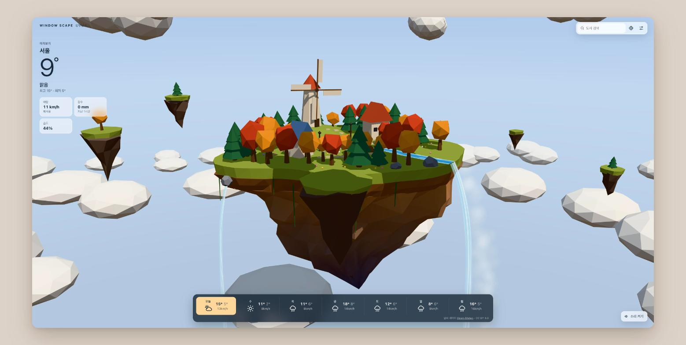</p>

---

안녕하세요 !
인스타그램 보다가 [Pascal Mager(@hellothere.de)님의 릴스](https://www.instagram.com/reel/DeNVdk7oPYA/)를 봤는데요,
Blender랑 Three.js로 만든 작은 섬이 실제 날씨에 맞춰 바뀌는 영상이었는데 보자마자 마음에 쏙 들더라고요.
그래서 저도 하나 만들어봤습니다.

원작은 웹사이트였는데 저는 그냥 바탕화면 구석에 늘 띄워두고 싶어서 위젯으로 만들었고요,
하늘섬 하나로 시작했다가 이것저것 붙이다 보니 테마가 다섯 개가 됐습니다.
(모델·코드는 전부 새로 만들었고, 원작에서는 '날씨에 따라 변하는 3D 미니어처'라는 아이디어만 빌려왔어요)

## 테마

<table>
  <tr>
    <td align="center" width="50%"><b>하늘섬</b><br>구름바다 위에 뜬 섬, 풍차와 폭포<br>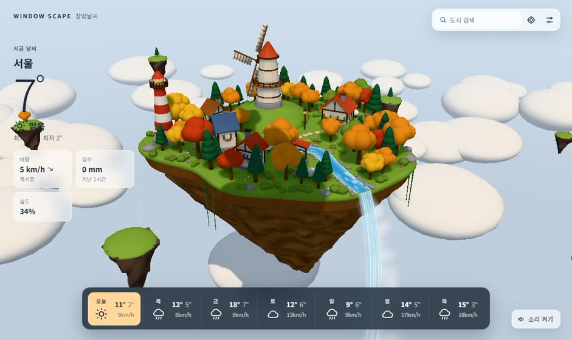</td>
    <td align="center" width="50%"><b>해안도로</b><br>지평선까지 뻗은 2차로 해안도로를 달리는 자동차, 등대 섬과 돛단배<br>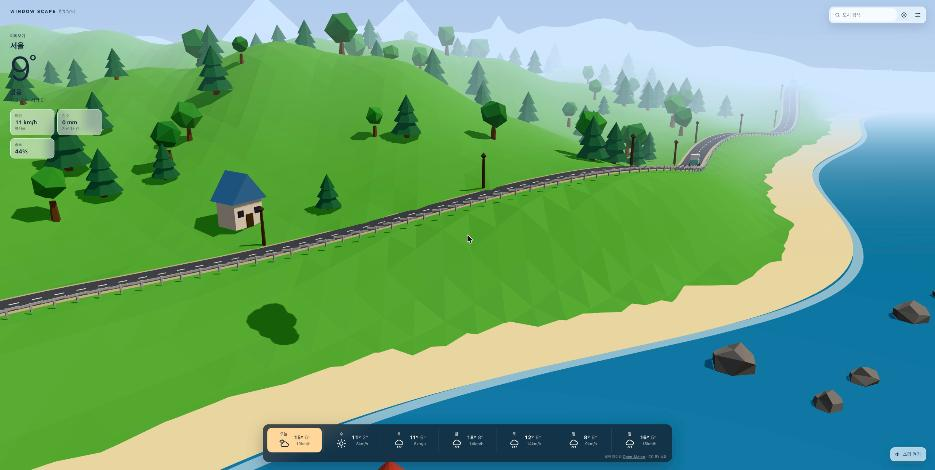</td>
  </tr>
  <tr>
    <td align="center"><b>피렌체 도시</b><br>강 위 가게 다리, 붉은 돔 성당, 강변 대관람차<br>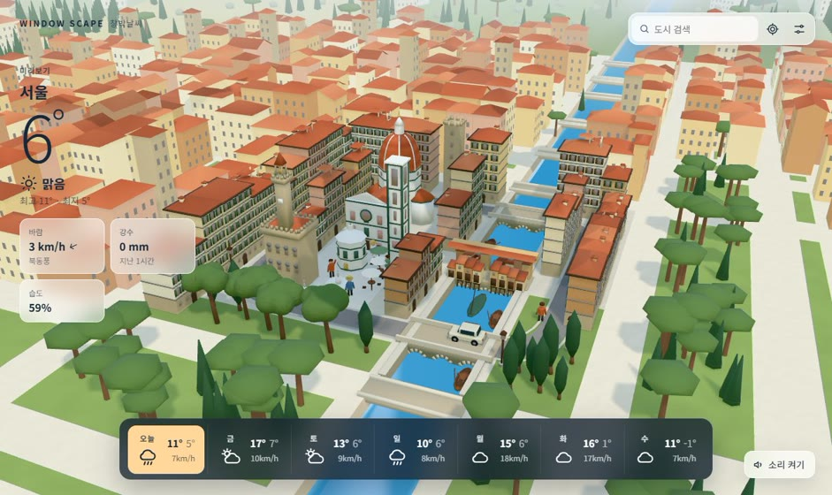</td>
    <td align="center"><b>움직이는 성</b><br>들꽃 핀 초록 언덕을 오르내리며 걷는 성<br>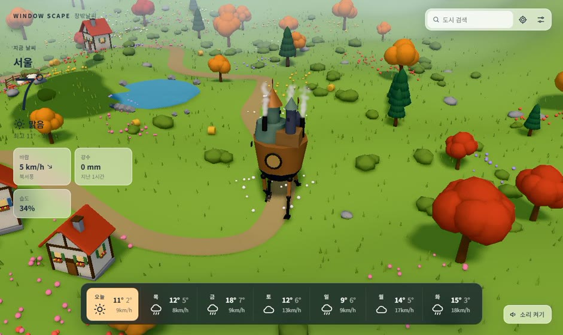</td>
  </tr>
  <tr>
    <td align="center"><b>숲</b><br>호숫가 통나무집, 사슴·여우·토끼가 노니는 들꽃 풀밭<br>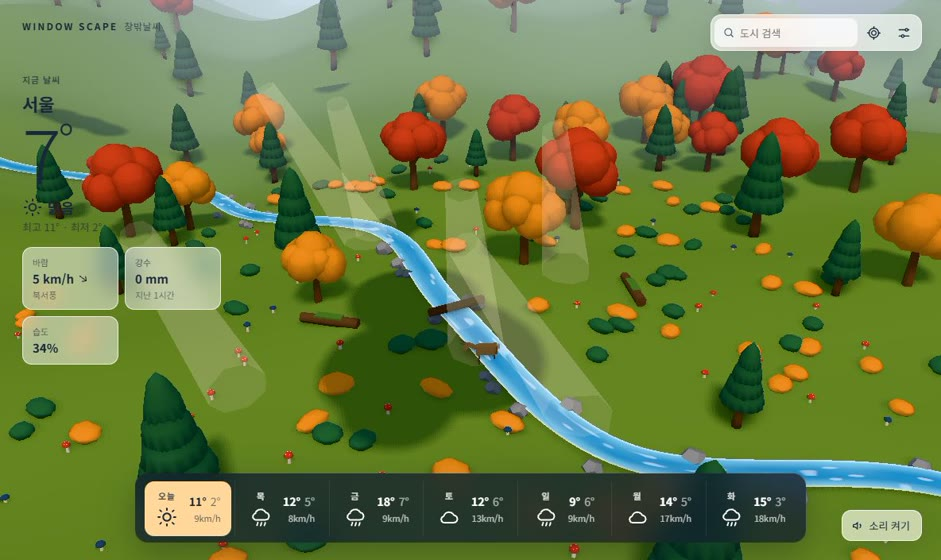</td>
    <td align="center"><b>바탕화면 위젯</b><br>작게 띄워두면 섬과 기온만<br>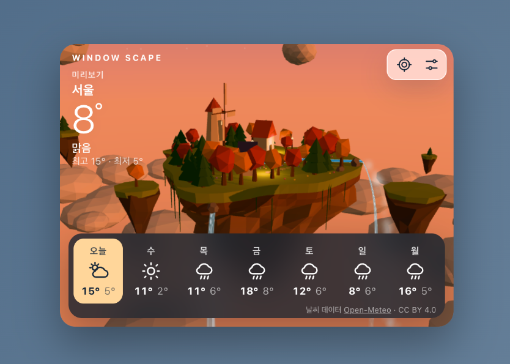</td>
  </tr>
</table>

움직이는 성은 지브리 느낌을 좋아해서 넣긴 했는데요,
영화 속 성을 그대로 옮기면 안 되니까 '네 발로 걷는 고철 성'이라는 발상만 가져와서 따로 디자인했습니다.

하늘섬을 뺀 네 테마는 설정의 '모양'에서 지평선까지 이어진 땅 대신 나무 받침에 올린 디오라마로도 볼 수 있어요.

## 날씨에 따라 바뀌는 것들

<table>
  <tr>
    <td align="center" width="50%"><b>밤 · 뇌우</b><br>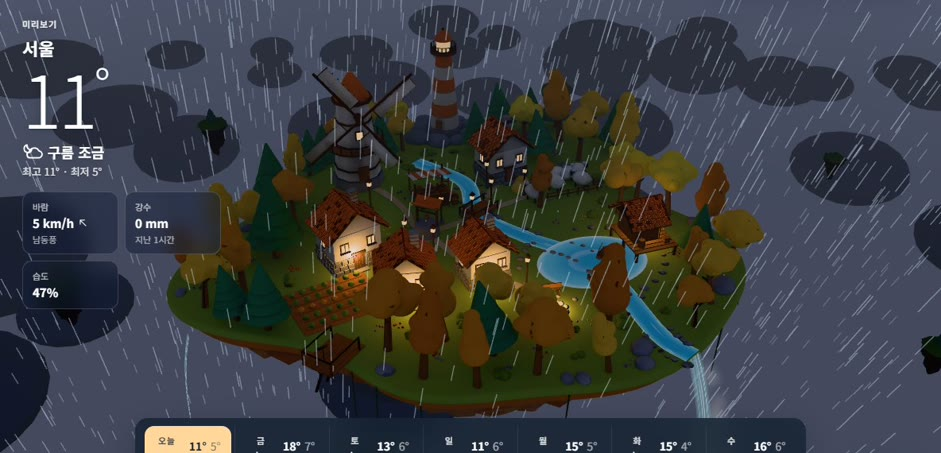</td>
    <td align="center" width="50%"><b>겨울 아침 · 눈</b><br>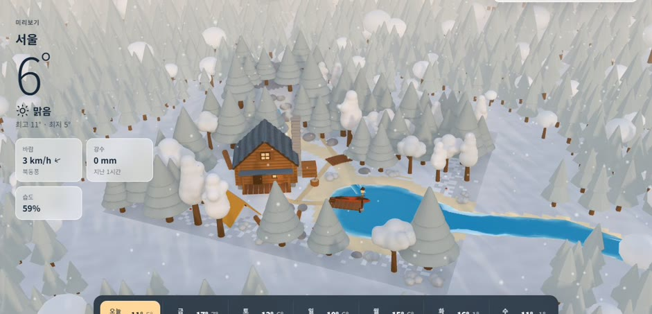</td>
  </tr>
  <tr>
    <td align="center"><b>밤 · 창문 불빛</b><br>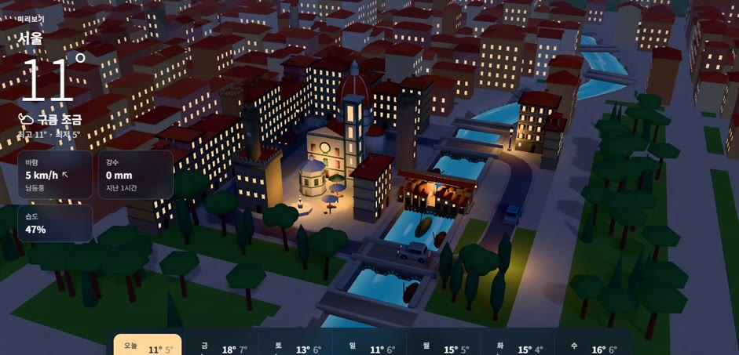</td>
    <td align="center"><b>저녁 노을</b><br>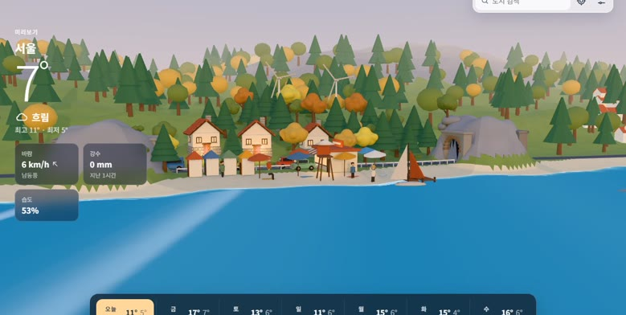</td>
  </tr>
</table>

- 시간대 - 아침·낮·저녁·밤에 따라 하늘색과 햇빛이 바뀌고, 밤에는 창문과 가로등에 불이 켜져요.
- 날씨 - 맑음부터 비·뇌우·눈·안개·무지개까지 10가지예요. 바람이 세면 풍차가 빨리 돌고 나무가 흔들립니다.
- 계절 - 봄엔 벚꽃, 가을엔 단풍이 들고, 실제 기온이 영하 근처면 눈이 쌓여요.
- 실시간 - 위치나 도시를 정해두면 지금 날씨 그대로 그려주고, 설정에서 아무 날씨나 골라 미리볼 수도 있어요.

## 위젯으로 쓰기

- 바탕화면 고정 / 항상 위 - 다른 창 뒤에 깔아둘 수도, 항상 맨 앞에 띄울 수도 있어요.
- 투명도 - 30%까지 내려서 배경처럼 은은하게 둘 수 있어요.
- 크기 - 창 크기에 맞춰 알아서 정보량이 바뀌어요. 작으면 섬과 기온만, 크면 7일 예보와 시간별 그래프까지 나옵니다.
- 자동 업데이트 - 새 버전이 나오면 알아서 받아서 설치해줘요.
- 그 밖에 - 현재 위치 날씨, 도시 검색, 로그인 시 자동 실행, 폭포·빗소리 배경음

## 설치

[최신 릴리스](https://github.com/ESeungJun/window-scape/releases/latest)에서 내 컴퓨터에 맞는 파일을 받아요.

| 컴퓨터 | 파일 |
| --- | --- |
| Mac (Apple Silicon, M1 이후) | `window-scape-…-mac-arm64.dmg` |
| Mac (Intel) | `window-scape-…-mac-x64.dmg` |
| Windows 10·11 (64비트) | `window-scape-…-windows-x64-setup.exe` |

- Mac - `창밖날씨.app`을 응용 프로그램 폴더로 옮기고 실행하면 끝이에요. Apple 공증을 받아서 경고 없이 바로 열립니다. (macOS 11 이상)
- Windows - 설치 파일을 실행해요. 코드 서명이 없어 SmartScreen 경고가 뜨면 `추가 정보` → `실행`을 누르면 됩니다.

처음엔 화면 오른쪽 위에 항상 위로 떠 있고, 메뉴 막대(Windows는 작업 표시줄 트레이)의 창문 아이콘에서 배치를 바꿀 수 있어요.

## 만든 방법

- 3D - [Three.js](https://threejs.org/). 모델 파일 없이 섬·건물·나무·성까지 전부 코드로 만들었어요.
- 데스크톱 앱 - [Tauri 2](https://tauri.app/). 앱이 10MB 정도라 늘 띄워놔도 가벼워요.
- 날씨 데이터 - [Open-Meteo](https://open-meteo.com/) (CC BY 4.0). API 키 없이 쓸 수 있어서 좋더라고요.

거의 Claude Code랑 같이 만들었는데요,
제가 한 건 주로 "이 테마는 이런 느낌이었으면 좋겠다"를 정하고 이상한 곳을 계속 짚어주는 쪽이었습니다.
(도시 테마는 처음에 창문이 너무 빽빽해서 좀 징그러웠는데 파스텔 장난감 도시로 갈아엎었어요,,)

## 개발

```bash
npm install
npm run dev                          # 웹 버전 http://localhost:5173
npm run tauri dev                    # 데스크톱 위젯 (처음 한 번 Rust 설치 필요: https://rustup.rs)
npm run build                        # 타입 검사 + 웹 빌드
```

웹 버전은 `F` 키나 `?showcase` 주소로 둥근 창 안에 화면을 담는 쇼케이스 모드를 켤 수 있어요.

<details>
<summary>구조와 릴리스 방법</summary>

| 경로 | 역할 |
|---|---|
| `src/scene/kit.ts` | 테마 공용 재료·소품·지형·나무 인스턴싱·폭포 |
| `src/scene/{island,drive,city,castle,forest}.ts` | 테마 다섯 개 |
| `src/scene/world.ts` | 렌더러·카메라·조명, 테마 전환, 프레임 루프 |
| `src/scene/{env,sky,clouds,precipitation}.ts` | 시간대·날씨·계절 연출, 하늘, 구름, 비·눈·번개·무지개 |
| `src/data/weather.ts` | Open-Meteo 예보·지명 검색, 날씨 코드 변환, 현지 시간대·계절 |
| `src/ui/*` | 현재 날씨, 예보, 보기 설정, 위젯 설정(배치·투명도·업데이트) |
| `src-tauri/` | Tauri 앱: 메뉴 막대, 창 배치, 현재 위치(CoreLocation), 업데이터 |

`v*` 태그를 푸시하면 GitHub Actions가 유니버설 앱을 Developer ID로 서명하고 Apple 공증을 받아서
DMG와 자동 업데이트 파일(`latest.json`)을 릴리스에 올려요.
필요한 Secrets는 `MAC_CERT_P12`, `MAC_CERT_PASSWORD`, `APPLE_API_KEY_P8`, `APPLE_API_KEY_ID`, `APPLE_API_ISSUER`,
`TAURI_SIGNING_PRIVATE_KEY`, `TAURI_SIGNING_PRIVATE_KEY_PASSWORD` 입니다.

</details>

## 고마운 분들

- 아이디어 - [Pascal Mager (@hellothere.de)](https://www.instagram.com/reel/DeNVdk7oPYA/)님의 "Blender + Threejs + Wetter" 릴스
- 날씨 데이터 - [Open-Meteo](https://open-meteo.com/) (CC BY 4.0)
