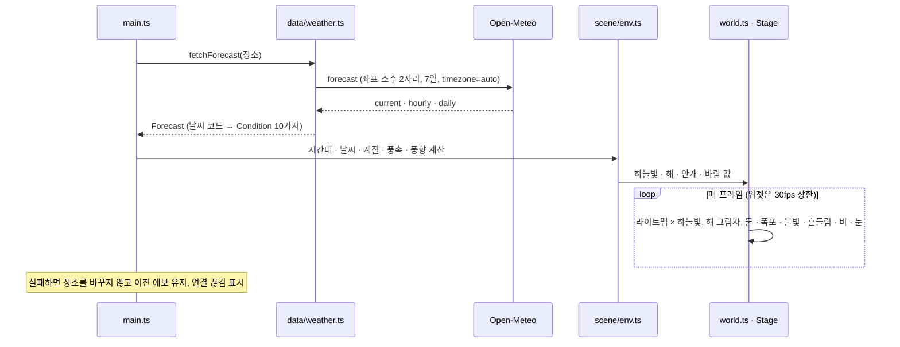
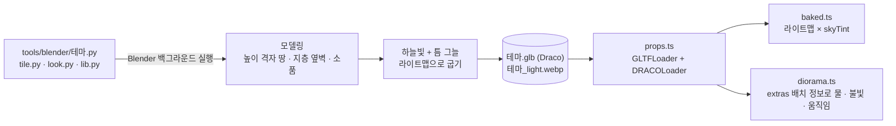
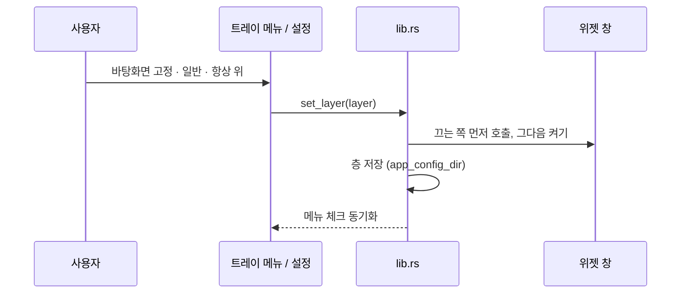
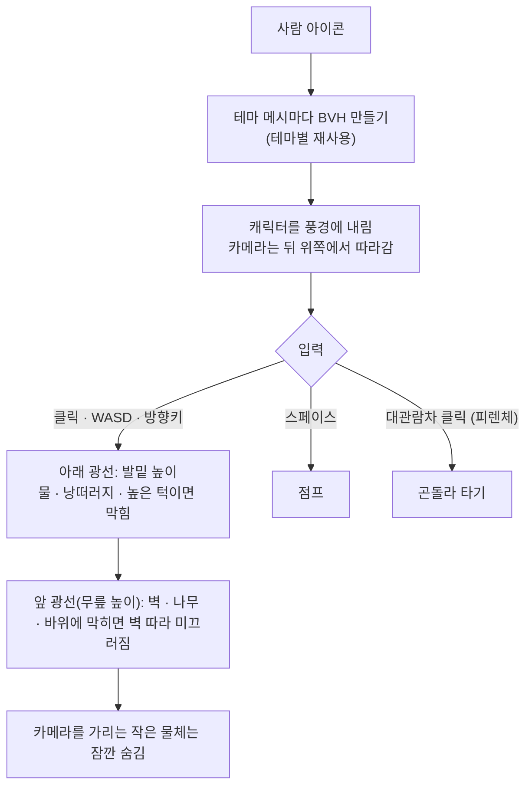

# 창밖날씨(WINDOW SCAPE) 구현도

> 2026-11-05에 v0.5.0 코드를 보고 정리했다.
> 함께 보기: [기획서](기획서.md) · [설계서](설계서.md) · [결정기록](결정기록.md)

## 폴더 구조

```text
window-scape/
├── index.html · vite.config.ts · tsconfig.json · package.json
├── src/                          화면 (웹·데스크톱 공용)
│   ├── main.ts                     상태, 장소·테마·모양 저장, 위치 찾기, 개발용 __view()·__info()
│   ├── widget.ts                   데스크톱 위젯 모드, Rust 명령 호출(current_location 등)
│   ├── util.ts · style.css
│   ├── data/weather.ts             Open-Meteo 예보·지명 검색, 날씨 코드 변환, 현지 시간대·계절
│   ├── scene/
│   │   ├── world.ts                  렌더러·카메라·조명, 테마 전환, 프레임 루프, 프레임 상한
│   │   ├── themes.ts                 테마 목록과 Stage 만들기(고정 시드)
│   │   ├── island.ts · drive.ts · city.ts · castle.ts · forest.ts  테마 다섯 개
│   │   ├── kit.ts                    공용 재질·소품·지형·나무 인스턴싱·폭포, Stage 인터페이스
│   │   ├── props.ts · baked.ts · diorama.ts  모델 불러오기(Draco), 라이트맵, 디오라마 공통 움직임
│   │   ├── env.ts · sky.ts · clouds.ts · precipitation.ts · water.ts  시간대·날씨·계절, 하늘, 구름, 비·눈·번개·무지개, 물 셰이더
│   │   └── explore.ts                들어가기 모드(캐릭터, 광선 검사, BVH)
│   └── ui/                         forecast.ts · search.ts · settings.ts · desktop-settings.ts · sound.ts · icons.ts
├── public/
│   ├── models/                     <테마>.glb, <테마>_light.webp
│   └── draco/                      Draco 해독기
├── tools/blender/                  island.py · drive.py · city.py · castle.py · forest.py · tile.py · look.py · lib.py
├── src-tauri/
│   ├── src/lib.rs                  트레이 메뉴, 창 층(바탕화면 고정·일반·항상 위), 모서리 붙이기, 명령
│   ├── src/location.rs             macOS CoreLocation, 좌표 소수 2자리
│   ├── tauri.conf.json · Cargo.toml · capabilities/default.json · Entitlements.plist · Info.plist
│   └── icons/
├── .github/workflows/release.yml   v* 태그 릴리스
└── docs/                           이 문서들, explore-character.md, images/
```

## 주요 흐름

### 날씨를 받아 장면에 반영



### Blender에서 앱까지 모델 만들기



### 위젯 창 층 바꾸기



### 들어가기 모드



## 핵심 파일

| 파일 | 설명 |
|---|---|
| [src/scene/world.ts](../src/scene/world.ts) | 렌더러·카메라·조명, 테마 전환, `setFrameCap`(위젯 30fps), 크기 바꿀 때 바로 다시 그리기 |
| [src/scene/kit.ts](../src/scene/kit.ts) | `Stage` 인터페이스, 공용 재질, `Sway`(바람 흔들림, dt 누적), `Waterfall`, `Floaters` |
| [src/scene/baked.ts](../src/scene/baked.ts) | 라이트맵 셰이더에 `skyTint`를 곱하는 패치 |
| [src/scene/explore.ts](../src/scene/explore.ts) | 들어가기 모드, three-mesh-bvh |
| [src/data/weather.ts](../src/data/weather.ts) | `fetchForecast`, 지명 검색, `Condition`·`TimeOfDay`·`Season` |
| [src/ui/desktop-settings.ts](../src/ui/desktop-settings.ts) | 창 배치, 투명도, 버전, 자동 업데이트(6시간마다) |
| [src-tauri/src/lib.rs](../src-tauri/src/lib.rs) | 트레이, 층(`get_layer`·`set_layer`), 모서리 붙이기, `current_location` |
| [src-tauri/src/location.rs](../src-tauri/src/location.rs) | CoreLocation, 실패 코드 `denied`·`unavailable`·`timeout` |
| [tools/blender/tile.py](../tools/blender/tile.py) | 땅 테마 공용 바닥(높이 격자, 지층 옆벽, 물 단면, 먼 풍경, 카메라 높이 격자 `mark_top`) |
| [.github/workflows/release.yml](../.github/workflows/release.yml) | 매트릭스 빌드, 맥 서명·공증·확인, 파일 이름 정리, `latest.json` 합치기 |

## 빌드·실행·배포

```bash
npm install
npm run dev            # 웹 버전 http://localhost:5173
npm run tauri dev      # 데스크톱 위젯 (Rust 필요: https://rustup.rs)
npm run build          # 타입 검사 + 웹 빌드
blender -b -P tools/blender/island.py -- public/models glb 384   # 테마 모델 다시 만들기
```

- 릴리스: `package.json`·`tauri.conf.json`·`Cargo.toml` 버전을 올리고 `vX.Y.Z` 태그를 푸시한다. Actions가 맥 arm64·x64(서명·공증), Windows x64(NSIS)를 빌드하고 `window-scape-<버전>-<플랫폼>.*`와 `latest.json`을 릴리스에 올린다.
- 필요한 Secrets 이름: `MAC_CERT_P12`, `MAC_CERT_PASSWORD`, `APPLE_API_KEY_P8`, `APPLE_API_KEY_ID`, `APPLE_API_ISSUER`, `TAURI_SIGNING_PRIVATE_KEY`, `TAURI_SIGNING_PRIVATE_KEY_PASSWORD`(값은 저장소에 없다).
- 깃 흐름: 큰 작업은 `feat/*`·`docs/*` 브랜치에서 PR로 `main`에 합쳤다(#1 새 룩, #3 덜어내기, #4 README, #5 들어가기 모드). 버전은 `main`에서 `chore: 버전 x.y.z` 커밋 뒤 태그. `develop` 브랜치는 2026-11-05 문서 작업 때 `main`에서 처음 만들었다.

## 버전·릴리스 현황

| 태그 | 날짜 | 내용 |
|---|---|---|
| v0.1.0 | 2026-10-27 | 하늘섬 첫 버전, Tauri 위젯, macOS 현재 위치, 서명·공증 릴리스 |
| v0.1.1 | 2026-10-27 | 7일 예보 반응형 배치, 로컬 빌드 위치 권한 수정 |
| v0.2.0 | 2026-10-27 | 테마 5종, 앱 이름 창밖날씨, 창문 아이콘 |
| v0.2.1 | 2026-10-27 | 위젯 설정(배치·투명도·버전·자동 업데이트), README |
| v0.2.2 | 2026-10-27 | 자동 업데이트 시험 |
| v0.2.3 | 2026-10-27 | 항상 위가 가려지던 문제, 그래프 크기 |
| v0.2.4 | 2026-10-27 | 요일 상세를 예보 바 안 띠로, 지금 날씨 아이콘 |
| v0.2.5 | 2026-10-27 | 실제 풍속·풍향 반영 |
| v0.2.6 | 2026-10-27 | 출처 표기를 설정 패널로 |
| v0.2.7 | 2026-10-27 | 기본 배치 항상 위, 맥(Apple Silicon·Intel)·윈도우 따로 빌드 |
| v0.3.0 | 2026-10-29 | 새 룩: 빛 굽기 하늘섬 + 지평선까지 트인 네 땅 테마(피렌체 도시 등) |
| v0.3.1 | 2026-10-29 | 사람 빼기, 도로 위 건물 정리, 물 표현, 날씨 글씨 흰색 |
| v0.4.0 | 2026-10-29 | 덜어내기, 대관람차, 숲 동물, 밝은 밤, 터널 없는 해안도로, 디오라마 모양 |
| v0.5.0 | 2026-11-01 | 들어가기 모드(3인칭 걷기, 점프, 대관람차 타기) |

- 첫 커밋 `b23ef0e`(2026-10-27 16:02)부터 v0.4.0까지 사흘(개발 글).

## 앞으로 할 일

- [ ] 들어가기 모드 캐릭터 모델을 시안([explore-character.md](explore-character.md))대로 Blender 스크립트로 만들기
- [ ] `feat/material-quality` 브랜치(재질·조명·후처리) 합칠지 정하기
- [ ] Windows 현재 위치, Windows 코드 서명
