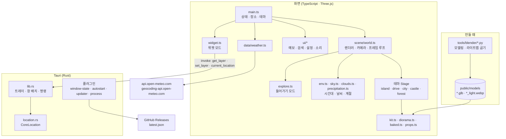

# 창밖날씨(WINDOW SCAPE) 설계서

> 2026-11-05에 v0.5.0 코드를 보고 정리했다.
> 함께 보기: [기획서](기획서.md) · [구현도](구현도.md) · [결정기록](결정기록.md)

## 기술 스택

| 영역 | 고른 것 | 이유 |
|---|---|---|
| 3D | Three.js 0.186, three-mesh-bvh | 원작이 Three.js였고, 웹으로 먼저 만들었다. 들어가기 모드의 광선 검사가 느려(광선 하나 약 19ms) BVH를 쓴다 |
| 모델 | Blender 파이썬 스크립트(`tools/blender/*.py`) → glb(Draco 압축) + 라이트맵 webp | 코드로 쌓은 도형은 장난감 블록 같았다. 손으로 다루지 않고 스크립트로 만들어 다시 만들기 쉽게 했다 |
| 화면 | TypeScript 7, Vite 8, 프레임워크 없음 | 화면이 3D 캔버스와 패널 몇 개라 빌드만 있으면 된다 |
| 데스크톱 | Tauri 2(Rust) | 늘 띄워 둘 위젯이라 가벼워야 한다. 설치 파일이 20MB 안쪽 |
| Tauri 플러그인 | window-state, autostart, updater, process | 위치·크기 기억, 로그인 시 실행, 자동 업데이트·재시작 |
| 현재 위치(macOS) | `objc2-core-location`(CoreLocation) | 앱 창 WebKit이 위치 권한을 처리하지 못했다(`f2d772e`) |
| 날씨 | Open-Meteo(CC BY 4.0) | API 키 없이 쓸 수 있다 |
| CI | GitHub Actions | `v*` 태그에 맥 arm64·x64, Windows x64를 각각 빌드·서명·공증 |

### 후보 비교

개발 글과 커밋에 남은 근거만 적는다. 웹 검색으로 비교한 기록은 없다.

| 결정 | 후보 | 고른 것과 이유 |
|---|---|---|
| 배포 형태 | 웹사이트(원작 방식) / 데스크톱 위젯 | 위젯. 바탕화면 구석에 늘 띄워 두고 싶었다 |
| 위젯 틀 | 기록 없음 | Tauri 2. 웹으로 먼저 만든 화면을 감싸고, 늘 띄워 둘 만큼 가볍다 |
| 모델 | 코드로 만든 도형 / Blender 모델 | Blender. 미니어처 느낌 |
| 빛 | 실시간 조명 전부 / 구운 빛 + 해만 실시간 | 구운 빛. 그늘은 부드러워지고 프레임은 도시 테마 255 → 1764 |
| 땅 테마 모양 | 공중 섬 / 지평선 풍경 / 받침 디오라마 / 미니어처 | 지평선 풍경을 기본으로, 미니어처는 설정에서 고름(디오라마는 1.0.0 뒤에 미니어처로 통일) |

## 전체 아키텍처

- 화면 코드는 웹과 데스크톱이 같다. Tauri 안에서 돌 때만 위젯 모드(`widget.ts`)와 Rust 명령을 쓴다.
- 테마는 `Stage` 인터페이스([kit.ts](../src/scene/kit.ts))로 나눈다: `group`, `kind`(`floating`·`ground`), `view`, `groundHeight`, `baked`, `setCase`, `update`. 테마마다 난수 시드를 고정해 새로고침해도 같은 배치가 나온다([themes.ts](../src/scene/themes.ts)).

## 데이터 구조

### 날씨 (Open-Meteo)

- 예보 요청: `current`(기온, 습도, 강수, 날씨 코드, 풍속, 풍향), `hourly`(기온, 날씨 코드, 강수 확률), `daily`(날씨 코드, 최고·최저, 일출·일몰, 강수 합, 최대 풍속, 주된 풍향), `timezone=auto`, 7일([weather.ts](../src/data/weather.ts)).
- 좌표는 소수 2자리로 줄여서 보낸다.
- 날씨 코드는 앱의 `Condition` 10가지로 바꾼다: `clear`, `partly`, `cloudy`, `wind`, `fog`, `rain`, `heavyRain`, `storm`, `snow`, `rainbow`.
- 시간대 `TimeOfDay`: `morning`·`day`·`evening`·`night`. 일출·일몰은 날짜를 포함한 절대 시각으로 비교한다(백야·극야·자정 넘는 일몰).
- 계절 `Season`: 현지 날짜 기준, 열대는 여름 고정. 눈 덮임은 실제 최저기온으로 정한다.

### 저장

| 무엇 | 어디 |
|---|---|
| 장소(이름, 좌표), 테마, 모양, 보기 설정 | 웹뷰 `localStorage`([main.ts](../src/main.ts), [desktop-settings.ts](../src/ui/desktop-settings.ts)) |
| 창 배치(바탕화면 고정·일반·항상 위) | Tauri 앱 설정 폴더(`app_config_dir`)의 파일([lib.rs](../src-tauri/src/lib.rs) `layer_path`) |
| 창 위치·크기 | `tauri-plugin-window-state` |
| 현재 위치 좌표 | 저장하지 않는다 |

### 모델 파일

- `public/models/<테마>.glb`: Draco 압축 장면. 물·불빛·움직이는 물체 자리 같은 배치 정보는 glb의 `extras`(layout)에서 읽는다(`79e102b`).
- `public/models/<테마>_light.webp`: 하늘빛·틈 그늘을 구운 라이트맵. 앱에서 시간대·날씨 하늘빛(`skyTint`)을 곱한다([baked.ts](../src/scene/baked.ts)).
- `public/draco/`: Draco 해독기.

## 플랫폼별 차이

| 항목 | macOS | Windows | 웹 |
|---|---|---|---|
| 창 | 테두리 없는 투명 창, `macOSPrivateApi` | 테두리 없는 투명 창 | 브라우저 창 |
| 트레이 | 메뉴 막대 창문 아이콘 | 작업 표시줄 트레이 | 없음 |
| Dock·작업 표시줄 | Dock 아이콘 없음 | `skipTaskbar` | - |
| 현재 위치 | CoreLocation(위치 권한 창) | 지원 안 함(`unavailable`) | 브라우저 `navigator.geolocation` |
| 설치 파일 | dmg(arm64·x64 따로) | NSIS setup.exe | - |
| 서명 | Developer ID + 공증, CI에서 확인 | 코드 서명 없음 | - |
| 자동 업데이트 파일 | `.app.tar.gz` | setup.exe 자체 | - |
| 창 높이 | 하나뿐이라 "항상 아래" 끄기가 "항상 위"를 덮어씀 → 끄는 쪽을 먼저 호출(`cdafeb9`) | - | - |

## 보안·권한

- CSP([tauri.conf.json](../src-tauri/tauri.conf.json)): `default-src 'self'`, 연결은 IPC와 Open-Meteo 두 주소만. Draco 해독기 때문에 `'wasm-unsafe-eval'`, `worker-src blob:`을 허용(`79e102b`).
- Tauri 권한([capabilities/default.json](../src-tauri/capabilities/default.json)): 기본 + 창 끌기·크기 조절 + 업데이터 + 재시작만.
- macOS 위치: hardened runtime에 `com.apple.security.personal-information.location` entitlement, 위치 권한 설명. 좌표는 Rust에서 소수 2자리로 줄이고 저장하지 않는다.
- 로컬 빌드도 번들 전체를 ad-hoc 서명(`signingIdentity: "-"`)해야 위치 권한 창이 뜬다. 링커 서명만 된 실행 파일은 TCC가 앱을 식별하지 못해 바로 거부한다(`5dd5e68`).
- 자동 업데이트: 업데이트 파일은 Tauri 업데이트 키로 서명하고 앱에는 공개 키만 넣는다. 받을 주소는 `releases/latest/download/latest.json` 하나.
- CI 서명 비밀값은 빌드 단계에만 넘기고, 인증서는 임시 키체인에 넣었다가 끝나면 지운다. 저장소에 비밀값은 없다.

## 알려진 한계

- Windows는 현재 위치를 못 쓴다. 코드 서명이 없어 SmartScreen 경고가 뜬다.
- 들어가기 모드는 시험 중이고 캐릭터는 임시 모양이다.
- 자동 시험 코드가 없다. 검증은 타입 검사, 화면 확인, 개발 서버 전용 `__view()`·`__info()`(그리기 호출·삼각형·메모리 수)로 한다.
- 모델을 끝내 못 불러오면 화면에 안내 문구만 띄운다(`e50f59a`).
- 카메라가 언덕·나무·집 속으로 들어가지 않게 높이 격자로 막지만, 격자 해상도만큼만 정확하다.
